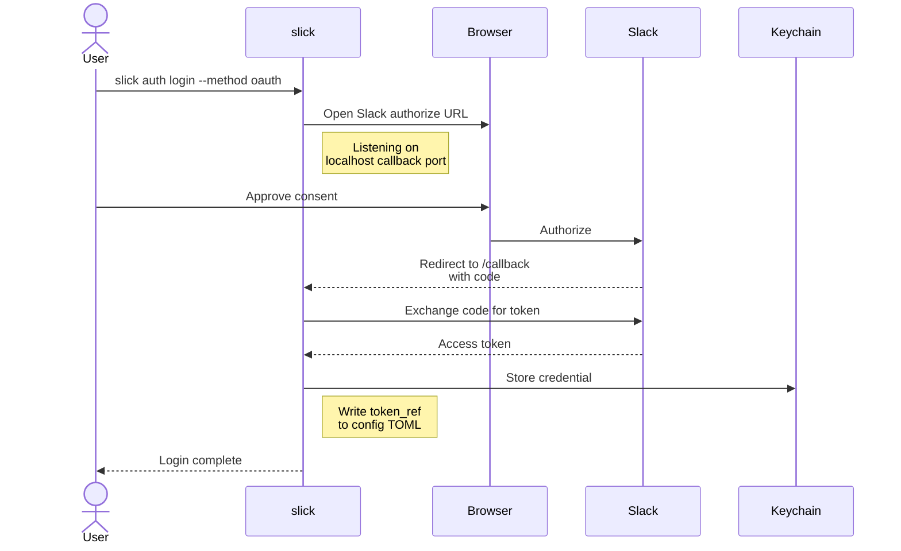

# slick auth

**Manage** Slack authentication. Login validates a token with the Slack API
and stores a structured credential in the local keychain. Config holds its
credential reference. Raw Slack tokens with known prefixes, including
rotating, refresh, app, and workflow tokens, are rejected when loading or saving
config. Validation errors
do not repeat the token value. A rejected credential value leaves the prior config intact;
repair an existing plaintext value by replacing it with a credential reference.

If result output fails after a local auth change is saved, slick exits 8.
The change remains applied. Check the saved profile or auth status before
retrying; slick does not repeat the operation or roll back saved credentials
because output failed.

## auth login

Token imports accept bot and user access tokens, including rotating `xoxe.`
forms. An imported access token has no refresh token and expires on Slack’s
schedule. Use browser OAuth to retain refresh support.

Create or replace a workspace profile.

Login saves only reviewed auth fields and a credential reference in config.
It reads the previous keychain value before writing, including with `--force`.
If that read fails, nothing is overwritten. Failed credential writes, or config
saves that fail before replacing the file, trigger a restore of the previous
credential or removal of a new entry.
If restoration also fails, the error includes
`details.credential_restore_failed: true`; check the keychain entry before
retrying. The previous config remains intact when replacement did not occur.

If the file was replaced but its directory could not be synced, login keeps the
new credential paired with the new profile and returns exit 5. Machine errors
include `config_published: true` and `durability_confirmed: false` in
`errors[].details`. The file is in place, but its survival across a crash is
unconfirmed. Inspect the saved profile before retrying.

Replacing an env, 1Password, or differently named keychain reference requires
`--force`. Login does not resolve or delete that old source. The forced login
saves the new credential in the profile's managed keychain entry and updates
the reference. If the profile already uses its managed entry and that entry
is missing, login can restore authentication without `--force`.

An existing malformed config must be repaired before logging in. Login does
not replace it with a new config.

The local profile name can come from either flag: the hidden
`--workspace-name <NAME>` (preferred) or the global `--workspace <NAME>`
selector — if `--workspace-name` is empty, slick reuses the value of
`--workspace`. On a TTY, omitting both drops into an interactive form
that prompts for the missing fields.

Use exactly one token source with `--method token`. OAuth client, redirect,
and callback-port flags require `--method oauth`; token source flags cannot
be used with OAuth. Choose either `--oauth-redirect-url` or
`--oauth-callback-port`, not both. Invalid combinations fail before reading
tokens or starting a browser. Callback ports range from 0 through 65535;
0 asks the OS to choose a port. Redirect URLs must use local HTTP, include
a port, and have no user credentials or fragment.

The callback accepts GET requests with the state from the current login.
Requests with missing, mismatched, or duplicate state values are rejected
without ending the login. Missing or ambiguous code/error fields are also
rejected, so a later valid callback can still complete the flow. A valid
authorization denial ends the login without exchanging a code or saving
credentials. Callback pages and terminal errors do not repeat the remote
error text.

`--dry-run` or `-n` checks the option shape and previews the canonical profile
name. It does not read token sources or the keychain, open a listener or
browser, call Slack, or change files. The result includes `dry_run: true`
and `authenticated: false`; a preview does not validate credentials or
promise that a real login will succeed. Provide the profile name for a
preview, including on a TTY.

For token mode, slick calls Slack's `auth.test` after validating the
token and fills in `team_id` / `team_name` from the response. Pass
`--team-id` / `--team-name` only if you need to override what Slack
returns (rare).

=== "Interactive"

    TTY only; prompts for workspace name, method, and whatever else is missing:

    ```sh
    slick auth login
    ```

=== "OAuth"

    Fully scripted. `--workspace-name` and `--oauth-client-id` are required, and `--oauth-callback-port` must match the redirect URL in your manifest:

    ```sh
    slick auth login --workspace-name default --method oauth \
        --oauth-client-id 1234567890.0987654321 \
        --oauth-callback-port 53221
    ```

=== "Token · stdin"

    The token never appears in argv, and slick derives the workspace identity from `auth.test`:

    ```sh
    printf '%s\n' "$SLACK_TOKEN" | slick auth login \
        --workspace-name default --method token --token-stdin
    ```

=== "Token · file"

    Read the token from a file; path expansion is supported:

    ```sh
    slick auth login --workspace-name default --method token \
        --token-file ~/.slack-token
    ```

=== "Token · env"

    Pass the name of an environment variable, not its value:

    ```sh
    slick auth login --workspace-name default --method token \
        --token-env SLACK_TOKEN
    ```

### Output

=== "Human"

    Human (success — same shape for OAuth and token-mode logins; both end with a
    single `Login complete` event on stdout):

    ```text
    Login complete workspace=default team_id=T123ABC456 team_name="Example Inc" token_type=user authenticated=true
    ```

    Human (token env var unset or empty — validation error):

    ```text
    ERR token environment variable is unset or empty type=validation_error exit_code=4
    ```

=== "JSON"

    JSON envelope on a successful login (`auth.login`):

    ```json
    {
      "ok": true,
      "meta": {"exit_code": 0, "command": "auth.login", "workspace": "default", "timestamp": "2026-05-26T03:00:56Z", "request_id": "337f5bd1-a5f2-4bb8-8da5-510cb801f62d"},
      "data": {
        "workspace": "default",
        "authenticated": true,
        "token_type": "user",
        "team_id": "T123ABC456",
        "team_name": "Example Inc"
      },
      "errors": []
    }
    ```

Token validation uses the shared Slack error codes: invalid credentials or
permissions exit 1; rate limits exit 3; malformed responses, server failures,
and transport failures exit 5; cancellation exits 6 and request timeouts exit 7.
These failures leave the previous config and saved credential intact. Debug
output uses safe SDK summaries and does not include request or response payloads.

### Flags

??? note "Flags"

    | Flag | Value | Description |
    |------|-------|-------------|
    | `--workspace-name` | `<NAME>` | Local profile name. Hidden in --help. Falls back to the global --workspace value when omitted. |
    | `-s`, `--token-stdin` | | Read Slack token from stdin |
    | `-f`, `--token-file` | `<FILE>` | Read Slack token from file |
    | `-e`, `--token-env` | `<VAR>` | Read Slack token from named environment variable |
    | `-T`, `--team-id` | `<ID>` | Slack workspace ID (overrides auth.test) |
    | `-N`, `--team-name` | `<NAME>` | Slack workspace display name (overrides auth.test) |
    | `-m`, `--method` | `<METHOD>` | Auth mechanism: oauth or token (default: token) |
    | `-C`, `--oauth-client-id` | `<ID>` | Slack OAuth client ID |
    | `-r`, `--oauth-redirect-url` | `<URL>` | Slack OAuth redirect URL configured on the app |
    | `-p`, `--oauth-callback-port` | `<PORT>` | Local OAuth callback port; 0 for OS-assigned |
    | `-F`, `--force` | | Overwrite an existing authenticated profile |

The profile-name resolution order is: `--workspace-name` flag, then the
global `--workspace` flag value, then the TTY interactive form. After
those, slick errors with `workspace-name is required` if it still
doesn't have one.

For token mode, slick calls `auth.test` after the token validates and
fills `team_id` / `team_name` from the response. Pass `--team-id` /
`--team-name` only when you need to override what Slack returns.

### OAuth flow

OAuth exchange and saved-token refresh reject redirects by default. Replies
need an explicit, consistent acknowledgement, a nonempty token without
whitespace, and valid whole-second expiry values. Negative, null or
unrepresentable expiry values are rejected. Responses are limited to 8 MiB.
Rejected refresh replies leave the saved credential intact.

1.  slick opens the Slack authorize URL in the default browser and listens on
   the configured local port.
2.  The Slack consent screen redirects back to `http://localhost:<port>/callback`.
3.  slick exchanges the code for a token, stores it in the keychain, and
   writes a `token_ref` to the config TOML.



During the wait, a spinner displays the authorize URL on stderr so you can
copy it if the browser launch fails. ++ctrl+c++ cancels the wait. The default
OAuth-wait budget is two minutes (`OAuthTimeout`); the token-exchange POST
gets its own fresh `--timeout` budget after a valid callback. Browser approval
can take longer than `--timeout`. Caller cancellation and caller deadlines
still apply throughout login, including the exchange and local save.

Browser-wait expiry remains an auth failure (exit 1), with `redirect_url` in
the error details. An exchange timeout or caller deadline exits 7; cancellation
exits 6. Rate limits exit 3 and permission failures exit 1. Slack validation
errors such as `invalid_arguments` exit 4. Malformed responses, server failures,
and transport failures exit 5. These failures do not save a new credential or change the
previous config. An occupied callback port exits 5 and includes
`callback_address`, without copying the underlying network error.

Known OAuth client, code, verifier, redirect, and PKCE setup errors remain auth
failures (exit 1). The error keeps Slack's defined code so you can correct the
setup or repeat browser approval. Unknown response text remains redacted.

### Common errors

| Error | Cause | Fix |
|-------|-------|-----|
| `workspace profile is already authenticated; rerun with --force to overwrite auth fields` | The profile uses another credential reference, or its managed keychain credential exists. | Pass `--force` to replace it. A missing managed keychain entry can be restored without `--force`. |
| `oauth flow timed out waiting redirect_url=…` | The OAuth window stayed open longer than `OAuthTimeout` (default 2m). | Re-run; consider raising `OAuthTimeout` if your IdP redirect is slow. |
| `invalid_auth` / `token_revoked` | Token is bad or has been revoked on Slack's side. | Re-run `auth login`. |

## auth status

Check every configured profile in name order. A missing or invalid credential
is reported in that profile’s result; the completed check still exits 0.
Cancellation exits 6 and a timeout exits 7, without a partial success result.
Provider and transport diagnostics are redacted. Known Slack error codes,
such as `invalid_auth`, remain visible.

With no profiles, JSON and compact output contain `workspaces: []`. Human
output says `No workspace profiles configured`. This command takes no
positional arguments and does not change your configuration.

Show auth state for every configured workspace. The action label colour-codes
state at a glance:

*   `Authenticated` (bold green) — credentials valid; `authenticated=true`.
*   `Authentication invalid` (red) — credentials exist but Slack rejected them.
*   `Credentials missing` (red) — workspace metadata exists; no credential in
  the keychain.

```sh
slick auth status
```

=== "Human"

    Human output:

    ```text
    Authenticated workspace=default team_id=T123ABC456 team_name="Example Inc" token_type=user authenticated=true
    ```

=== "JSON"

    JSON data excerpt (authenticated profile):

    ```json
    {
      "data": {
        "workspaces": [
          {
            "workspace": "default",
            "authenticated": true,
            "token_type": "user",
            "team_id": "T123ABC456",
            "team_name": "Example Inc",
            "validation_state": "valid"
          }
        ]
      }
    }
    ```

    JSON data excerpt (a configured credential was removed outside slick).
    Workspace metadata is still present, but `validation_state` is `missing`
    and `authenticated` is `false`:

    ```json
    {
      "data": {
        "workspaces": [
          {
            "workspace": "default",
            "authenticated": false,
            "token_type": "user",
            "team_id": "T123ABC456",
            "team_name": "Example Inc",
            "validation_state": "missing"
          }
        ]
      }
    }
    ```

## auth switch

Change the default workspace used when `--workspace` is omitted.

```sh
slick auth switch <workspace>
```

Names match without regard to case; the stored spelling is preserved.
Whitespace in the argument is trimmed; `--debug` logs the trim. Switching
is local and does not read credentials or call Slack.

Use `--dry-run` or `-n` to preview the canonical target without changing the
config. Preview results include `dry_run: true`. A save failure before file
replacement leaves the previous default and all profile settings intact. If
replacement succeeded but directory sync failed, the new default stays applied
and the error reports `config_published: true` with
`durability_confirmed: false`. Cancellation exits 6;
timeouts exit 7. Result metadata names the selected target.

### Output

=== "Human"

    Human:

    ```text
    Workspace switched workspace=default authenticated=false
    ```

=== "JSON"

    JSON data excerpt (`auth.switch`). Switching selects a profile without
    validating its credentials. The receipt includes `authenticated: false`;
    use `auth status` to check authentication.

    ```json
    {
      "data": {
        "workspace": "default",
        "authenticated": false
      }
    }
    ```

## auth logout

Names match without regard to case. `--dry-run` or `-n` previews the local
logout without reading credentials, calling Slack, or changing files.

Logout first saves the config change. If that fails before file replacement,
the previous config and credentials stay intact. If replacement succeeded but
directory sync failed, the local config change stays applied. The exit-5 error
reports `config_published: true`, `durability_confirmed: false`, and
`credential_cleanup_attempted: false`; revocation and keychain deletion have
not run. Inspect the config and remaining credential before retrying.

Profiles keep their preferences,
including an explicit attribution setting of either `true` or `false`.
A profile with no remaining preferences is removed. Removing the default
selects the first remaining profile in name order; removing the last
profile removes the config file.

After saving, slick tries to revoke the token and delete its keychain entry.
An unresolved configured credential, or a failure in either step, produces a
redacted warning on stderr while local
logout continues. Slack must explicitly confirm `revoked: true`; an explicit
`false` also produces a warning. A failed revocation may leave the token active; a failed
keychain deletion may leave the saved credential available.

Logging out removes auth fields and preserves configured preferences. If no
profiles remain, slick removes the empty config file.

Revoke the token on Slack and delete the local credential. With `--keep-token`,
slick removes the workspace's auth fields from config but leaves the keychain
credential alone and skips Slack-side revocation.

```sh
slick auth logout <workspace>
slick auth logout default --keep-token
```

### Flags

??? note "Flags"

    | Flag | Value | Description |
    |------|-------|-------------|
    | `-K`, `--keep-token` | | Skip token revocation and local credential deletion; only removes the workspace auth fields from config |

`--keep-token` emits an Info-level notice on stderr explaining that the token
remains active in the workspace until manually revoked or it expires.

### Output

=== "Human"

    Human (destructive logout — revokes via the Slack API, deletes the keychain entry):

    ```text
    Logout complete workspace=default authenticated=false
    ```

    Human (`--keep-token`). The first line is the Info-level notice on stderr;
    the second is the result event on stdout:

    ```text
    INF --keep-token preserves the credential in keychain; the token is still valid on Slack's side until manually revoked or it naturally expires workspace=default
    Logout complete workspace=default authenticated=false
    ```

=== "JSON"

    JSON data excerpt (`auth.logout`). `authenticated` is forced to `false`:

    ```json
    {
      "data": {
        "workspace": "default",
        "authenticated": false
      }
    }
    ```

!!! note "Retained credentials do not sign you back in"
    `--keep-token` leaves the credential in keychain but removes its reference
    from the profile. Later commands do not automatically discover that entry.
    Authenticate again to restore the reference. An explicit token environment
    override can still authenticate the profile; it is independent of the
    removed reference.

## See also

*   [Manifest](manifest.md) — generate a Slack app manifest that matches the
  scopes you want.
*   [Config](config.md) — workspace preferences (default channel, attribution).
*   [Workspace](workspace.md) — list configured profiles.
*   Slack API methods: [`auth.test`](https://docs.slack.dev/reference/methods/auth.test/),
  [`oauth.v2.access`](https://docs.slack.dev/reference/methods/oauth.v2.access/),
  [`auth.revoke`](https://docs.slack.dev/reference/methods/auth.revoke/).
