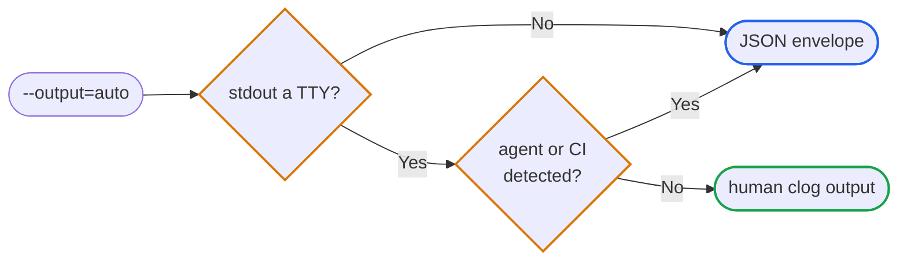

# Overview

`slick` is a headless Slack CLI for agents, scripts, and CI jobs — anywhere
you need to talk to the Slack API without a human at the keyboard.

**Send** messages and DMs, **reply** in threads, **react** to messages, **read**
channel and thread history, **search** the workspace, **set** your Slack
status, **upload** files, and **check** Slack service health — all from a
single binary that runs each of these non-interactively. Drive it with flags, stdin, or environment
variables, and the output adapts to where it runs: friendly colored text in a
terminal, structured JSON when piped or under an agent.

The binary is `slick`; the repo and Go module are `slack-cli`.

For agents, the documentation is available as an [llms.txt index](https://matcra587.github.io/slack-cli/llms.txt)
and a [single full-text file](https://matcra587.github.io/slack-cli/llms-full.txt).
Use **Copy as Markdown** at the top of any page to copy its rendered content.

Running `slick` without a subcommand lists its commands without resolving
credentials. Printing shell completion scripts also needs no token.

## Install

```sh
brew install matcra587/tap/slick
```

Also available via `go install` and pre-built binaries. See
[Installation](installation.md) for go install, GitHub Releases, source
builds, and upgrade paths.

The examples below assume `slick` is on `PATH`. Run `slick <command> --help` for the current flags and short forms.

## First-time setup

??? info "Prerequisite — an installed Slack app"
    slick uses a user or bot token from a Slack app installed in your workspace.
    Choose scopes for the commands you plan to run. Common scopes include:

    | Scope | Enables |
    |---|---|
    | `chat:write` | Send messages |
    | `channels:read` | Resolve public channels |
    | `users:read` | User lookup |

    Create the app at [api.slack.com/apps](https://api.slack.com/apps). See
    [manifest](manifest.md) for an optional `slick manifest template`
    shortcut that emits a ready-to-import manifest — and for broader scope
    sets (history, DMs, reactions, file uploads, search, status updates).

User tokens support actions such as search and personal status updates.
Bot tokens support the bot’s permitted conversations and actions. The
[manifest presets](manifest.md) list scopes for each token type. `auth.test`
does not need a separate OAuth scope.

With the app installed:

```sh
slick auth login
slick auth status
```

`auth login` opens a browser for OAuth (a token via stdin / env / file is also
supported); `auth status` confirms the workspace is wired up. See
[auth](auth.md) for the full flow.

## Output modes

slick has a single output flag, `--output` (short `-o`), with four values:

*   `auto` — the default. TTY without an agent renders human-readable clog
    output; everything else renders the JSON envelope.
*   `human` — human-readable clog output.
*   `json` — full envelope with `ok`, `meta`, `data`, and `errors[]`.
*   `compact` — JSON `data` on success; the full envelope on failure.

Under `auto`, JSON is selected when stdout is not a TTY or when slick detects
an agent environment (e.g. `CLAUDE_CODE`, `CURSOR_TERMINAL`, `CODEX`,
`GITHUB_ACTIONS`, `CI`).



Use command-local `--blocks` when the message body is already a Slack Block
Kit JSON array.

`--timeout` (`-I`) defaults to `30s`. Positive values add a command deadline.
Zero and negative values add no deadline; they preserve any existing caller
deadline and cancellation. Command-specific limits still apply.

`--debug` (or `-D`) adds diagnostics on stderr. SDK diagnostics keep safe
HTTP status and event summaries. They omit request payloads, response headers
and bodies, and unknown diagnostic text, which can contain credentials, message
content, or signed URLs. Machine results keep the same stdout format.

## Exit codes

| Code | Meaning |
|------|---------|
| 0 | Success |
| 1 | `auth_failure` (`invalid_auth`, `missing_scope`, `no_permission`, expired) |
| 2 | `not_found` (`channel_not_found`, `user_not_found`, `not_in_channel`, …) |
| 3 | `rate_limit` (`retry_after_seconds` is included when Slack supplies timing) |
| 4 | `validation_error` (bad flags, malformed input, Slack rejects the value) |
| 5 | `server_error` (unexpected HTTP response or filesystem/runtime failure) |
| 6 | `canceled` (command or credential lookup canceled) |
| 7 | `timeout` (command or credential lookup deadline exceeded) |
| 8 | `io` (`output_write_failed`; a mutation may already have completed) |

JSON and compact failures write a full `{ok, meta, data, errors}` envelope
to stdout, with `ok=false`, `data=null`, and the original error class and exit
code. Human errors use stderr and include `retry_after_seconds` when known,
including zero. A machine failure has no duplicate human error.
Help and shell completion scripts keep their text format in every output mode.
If writing that text fails, slick returns exit 8, reports `output_write_failed`
on stderr, and stops writing. Discard any partial text.
Credential lookup failures use exit 1 with a safe diagnostic. Provider output
is not included because it may contain secrets. Cancellation and deadlines
keep exit 6 and 7, including during credential lookup. An empty credential
stops the command before any Slack request.

Compact success still emits the command data directly. Paginated command data
includes `pagination`; JSON also keeps `meta.pagination` for compatibility.
List pagination includes `items_returned`, including `0` for an empty page.
Human list output keeps the rows and adds a footer with `has_more`, the count,
and any next cursor or time boundary. A final page shows `has_more=false`.

Recognized Slack JSON errors distinguish recovery: `token_expired` and
`access_denied` use exit 1; `file_not_found`, `thread_not_found`, and
`invalid_scheduled_message_id` use exit 2. `rate_limited` and `ratelimited` use
exit 3. Bad timestamps, stale cursors, invalid rich content, and the reaction
limits listed in the command docs use exit 4. Internal failures and unrecognized
Slack error codes keep exit 5. These classes do not trigger automatic mutation
retries.

HTTP `429` uses exit 3 even when `Retry-After` is missing or unusable. A usable
nonnegative integer delay allows at most two automatic retries. Missing,
invalid, duplicate, or excessively long timing returns the rate-limit error
immediately. Known timing is included as `retry_after_seconds`, including zero;
unknown timing is omitted. A valid integer delay that exceeds the supported
wait duration is reported without scheduling a retry.

`--no-throttle` disables proactive pacing; bounded retries for usable rate-limit
timing remain enabled. Cancellation or a deadline during a retry wait uses exit
6 or 7. Other unexpected HTTP responses, including `401` and `403`, use exit 5.
Slack JSON errors such as `invalid_auth` and `missing_scope` use exit 1.

Slack request failures use safe diagnostic summaries. HTTP failures retain the
numeric status, but omit the server's reason phrase and request URL. Malformed
error codes and unrecognized scope names are omitted. Missing-scope errors
prefer Slack's structured `needed` field and fall back to metadata messages
when the SDK preserves them. Some SDK response types discard those messages,
so a missing-scope failure may have no `needed` detail.

When present, `errors[].details.needed` is always an array of scope names.
`needed_match` explains the list: `all` requires every named scope; `any`
requires at least one. `reported` means Slack supplied the names and slick
does not infer an all-or-any rule from them. Unrecognized scope names are
omitted from diagnostics.

A result-write failure exits 8 in human, JSON, and compact modes. A mutation
may already have completed: inspect Slack before retrying it. Slick does not
retry the failed result destination. Output diagnostics omit the underlying
writer error text, which can contain private data. If a human error cannot be
written to stderr, slick also exits 8 and leaves stdout empty. Bare `slick`
returns command discovery in machine modes; explicit `--help` remains help text.
Flag and argument parsing failures identify the selected command in
`meta.command`, using its canonical name even when invoked through an alias.
Early failures retain the requested workspace, using its configured spelling
when known, or the configured default when no profile was selected. Formatting
these errors does not read credentials or call Slack.

## Output styling

slick uses [`gechr/clog`](https://github.com/gechr/clog) for human-mode output
and [`gechr/primer/table`](https://github.com/gechr/primer) for tables.

| Field kind | Rendering |
|---|---|
| **Identity** — `channel`, `user`, `team_id`, `workspace`, `file_id`, … | Hash-coloured from the entity palette; the same ID always renders the same colour. |
| **Human labels** — channel name, user name, file name | Plain terminal text — no colour, no hyperlink, no weight. |
| **Slack entity / permalink** | OSC 8 terminal hyperlinks when slick has enough workspace metadata. `channel_url` uses `slack://` on macOS, `https://app.slack.com/client/<team>/<conversation>` elsewhere; absent without a team ID. Parse JSON for raw IDs. |
| **Time** — `ts`, `fetched_at`, `expiration` | clog's `FieldTime` magenta. |
| **Bool** | Coloured by polarity — see below. |

Bool polarity:

| Tier | Examples | True | False |
|---|---|:-:|:-:|
| Alarming-on-true | `is_archived`, `deleted`, `truncated` | red | dim |
| Both states matter | `authenticated`, `exists` | green | red |
| Routine-on-true | `is_member` | dim | default |

`dry_run` and [`cache clear`](cache.md#cache-clear)'s `cleared` are retained
where they're the only signal of what happened; otherwise the action label
plus `errors[]` carries success/failure.

Field order follows a canonical taxonomy:
*where → what → when → state → detail → numbers → diagnostics → pagination*.
An AST-walking test enforces it on every CI run — see
[`internal/cli/output/field_order_test.go`](https://github.com/matcra587/slack-cli/blob/main/internal/cli/output/field_order_test.go).

## Attribution

In an agent or CI environment, the four mutating commands (`message send`,
`message edit`, `reply`, `file upload`) attach a Block Kit context block
marking the message as automated. Override per call with
`--attribution-label`, `--attribution-emoji`, `--attribution-message`, or
gate the block itself with `--attribution` / `--no-attribution` — both
flags trump config defaults *and* env detection, so a single command can
attribute on a workspace where it's off (or suppress where it's on).

??? note "Detection triggers"

    The authoritative list lives in [`internal/agent/detect.go`](https://github.com/matcra587/slack-cli/blob/main/internal/agent/detect.go).

    *   **AI assistants** — Claude Code, Cursor, Codex, Aider, Cline, Windsurf,
        GitHub Copilot, Codeium, Amazon Q, Gemini Code Assist, Cody.
    *   **CI** — GitHub Actions, Buildkite, Jenkins, GitLab CI, CircleCI,
        Travis CI, Bitbucket Pipelines, TeamCity, Azure Pipelines, plus the
        generic `CI` variable.
    *   **Cron / automation** — `CRON`, `CRON_JOB`, `SLACK_CLI_AGENT`.

The attribution context block reflects the detection state in the rendered
Slack message:

*   :robot_face: *Sent via slick (agent mode)* — slick auto-detected an
    agent or CI environment.
*   :robot_face: *Sent via slick* — slick is running interactively (no
    agent triggers) but `attribution.enabled = true` is set in config, or
    `--attribution` is passed on the command line.

Override either piece with `--attribution-message` (text body) or
`--attribution-emoji` (leading emoji).

Config can pin attribution defaults per workspace:

```sh
slick config set workspaces.default.attribution.enabled true
slick config set workspaces.default.attribution.emoji :robot_face:
slick config set workspaces.default.attribution.message "Sent via build agent"
```

## Configuration paths

*   Config: `${SLICK_CONFIG:-${XDG_CONFIG_HOME:-~/.config}/slick/config.toml}`.
  `SLACK_CLI_CONFIG` remains as a legacy override.
*   Cache: `${XDG_CACHE_HOME:-~/.cache}/slick/<profile>/` for ordinary names.
    [Special or long profile names](cache.md) use stable folder identifiers.
*   Path inputs (`SLICK_CONFIG`, `--token-file`, `--file`, …) expand `~` and
  environment variables.

Tokens never appear in argv, TOML, stdout, stderr, or any of these docs.
Auth-owned fields store keychain or secret-manager references; config
commands do not edit them.

## Further reading

*   Per-command pages above for flags, examples, and JSON shapes.
*   [`slick agent guide`](agent.md#guides) for machine-readable runbooks designed for
  agent consumption.
*   [`slick agent schema`](agent.md#schema) for the full command tree and exit-code
  contract in JSON.
*   [Repo source](https://github.com/matcra587/slack-cli)
